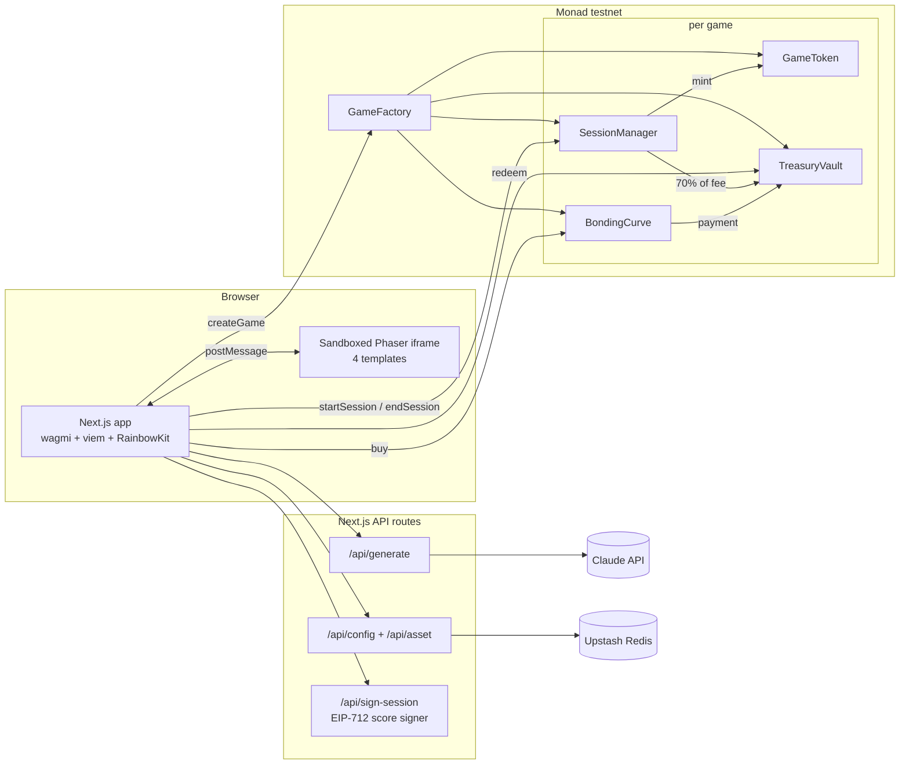

# Proof-of-Play

**Prompt a game. Launch a coin. Every run pumps an unruggable floor.**

Built for Monad Blitz Mumbai.

| | |
| --- | --- |
| **Live app** | https://proof-of-play-wheat.vercel.app (Monad testnet) |
| **GameFactory v2** | [`0xa8294480d7fc4735a350a9b32c582bcd821fa69c`](https://testnet.monadexplorer.com/contracts/full_match/10143/0xa8294480d7fc4735a350a9b32c582bcd821fa69c/) (verified) |
| **Whitepaper** | https://claude.ai/artifact/9BvddQxwwcqWG14mgvx8GA |
| **Demo script** | [docs/DEMO.md](docs/DEMO.md) |

---

## The problem

Launchpad tokens go to zero. Snipers and insiders buy the first block, the dev wallet holds a free bag, and the
chart is a single green candle followed by a long red one. When a launchpad coin is tied to a game, the game
usually doesn't matter. Nobody has to play it to get the coin.

## The solution

Proof-of-Play is a game launchpad where **the fair launch is mined by playing**.

- **Play-mined fair launch.** Early coins can only be earned by paying for a run and playing it. Better score, bigger share. You can't snipe a game you have to outplay.
- **Unruggable vault floor.** Every paid run fills a per-game `TreasuryVault`. Any holder can redeem against it at any time at `floor = vault ÷ supply`. No admin can withdraw it.
- **Creators earn MON, not free coins.** The creator's cut goes into a MON escrow that unlocks at **3 / 10 / 25 / 50 unique players**. There is no dev allocation.
- **Remixes pay the parent.** Fork any game. 10% of each remix run goes into the parent game's vault, which lifts the parent's floor.

## Why the floor only goes up

Each action that touches the vault keeps `vault ÷ supply` the same or raises it:

| Action | What happens | Floor |
| --- | --- | --- |
| **Run (mining)** | Mints at most the run's vault deposit worth of coins at the current floor. Score sets the share: 25% at score 0, rising to 100% at 40+. | ≥ (up whenever the share is below 100%) |
| **Buy (curve)** | Price is always ≥ floor + 10%, and the full payment goes into the vault | ↑ |
| **Redeem** | Burns coins and pays their exact share of the vault | = |
| **Creator payout** | Paid from the separate MON escrow, never from the vault | = |

Tested in `contracts/test/ProofOfPlay.test.ts`: **7 Hardhat tests**, including a fuzz test of **60 random
plays, buys and redeems** where the floor never drops.

### Economics

- **Entry fee:** 0.02 MON per run. **70% → vault**, **30% → creator escrow**. On remixes the 30% becomes **20% creator + 10% parent vault**.
- **Mining closes** at 10,000 coins mined or 300 runs, whichever comes first. Trading opens after that.
- **Bonding curve:** 0.0005 MON base + 0.0001 MON per 1,000 coins sold, and never below floor + 10%.

## Features

- **AI game generation with Claude** (~20 s). A prompt becomes a game config on one of 4 Phaser templates: **tap-to-fly, runner, shooter, dodge**.
- **Creator uploads** ("Make it yours"): your own sprites, sounds and particles.
- **Game feel and a meme layer:** combos, near misses, a REKT death screen, and a pumping candlestick chart in the background.
- **Live degen feed** built from on-chain events (mines, buys, redeems, launches).
- **Share to X** after every run.
- **Score signer** (EIP-712) that caps a plausible score by the time since the session started.

## Architecture



- **GameFactory** deploys a GameToken, TreasuryVault, SessionManager and BondingCurve for each game. It stores the config hash and the parent game for remixes.
- **SessionManager** takes the 0.02 MON entry, checks the signed score in `endSession`, mints coins, tracks unique players and holds the creator escrow (`claimCreator`, milestones).
- **TreasuryVault** holds the MON. `floorPrice()` is vault ÷ supply. `redeem()` pays a holder's exact share.
- **BondingCurve** opens after mining closes. `buy()` charges at least floor + 10% and sends the payment to the vault.

## Repo layout

| Path | What |
| --- | --- |
| `contracts/contracts/` | Solidity: `GameFactory`, `GameToken`, `TreasuryVault`, `SessionManager`, `BondingCurve` (OpenZeppelin) |
| `contracts/test/` | Hardhat tests (viem toolbox), including the floor-never-drops fuzz test |
| `web/src/app/` | Next.js 15 app: home, `create`, `game`, plus API routes |
| `web/src/app/api/` | `generate` (Claude), `config` + `asset` (Upstash Redis), `sign-session` (score signer) |
| `web/scripts/` | Seeding and demo helpers (below) |
| `docs/DEMO.md` | 3-minute demo script |

## Setup

```bash
# contracts
cd contracts && npm install && cp .env.example .env
npx hardhat test

# web
cd ../web && npm install && cp .env.example .env.local
npm run dev
```

Fill in the env files first: deployer key, signer key, Anthropic key, Upstash Redis and the factory address.
Network: Monad testnet, chain id `10143`, RPC `https://testnet-rpc.monad.xyz`.

### Scripts (run from `web/`, with `npx tsx`)

| Script | What it does |
| --- | --- |
| `scripts/seed.ts` | Seeds the demo games end to end: saves the config, runs `createGame`, has players pay, play, get a signed score and claim coins. On the last game it also closes mining, buys, redeems and claims the creator payout. Needs the dev server running. `ONLY=...` and `SKIP_TRADE=1` limit what it does. |
| `scripts/seed-play.ts` | Plays existing games with fresh funded wallets to build history. On the last game it closes mining, buys, redeems and claims the creator escrow. `GAMES=1,2,3,4,5` |
| `scripts/play-once.ts` | Plays one paid session as the deployer, for demos and for checking the live feed. `GAME=5` |
| `scripts/open-trading.ts` | Closes mining on a game as the creator, buys some coins and redeems a few, printing the floor at each step. `GAME=2` |

## Roadmap

- **Provable scores.** Seeded, deterministic replays that anyone can check, so no trusted signer is needed.
- **Tournament launches.** The launch is a timed competition, and the leaderboard sets the allocation.
- **The coin as a ranked-play ticket.** Holding or spending the coin gets you into ranked runs.
- **Holder-voted seasons.** Holders vote on new levels, modes and remixes.
- **Skill-staked runs.** Stake on your own run and get paid for beating a target score.
- **Protocol fee.** Planned: about 10% of entry fees plus half of a curve trade fee. *Not deployed.*
- **ORE-style rounds and a jackpot.** Timed mining rounds with a shared pot for the top player.

## Honest limits

- **Testnet only.** Monad testnet, not mainnet.
- **Unaudited.** The contracts are tested but have not been audited.
- **Scores come from the browser.** The browser reports the score and our server signs it. The signer caps scores by time played, but a determined cheater could still fake a plausible score. Provable replays are on the roadmap to fix this.
